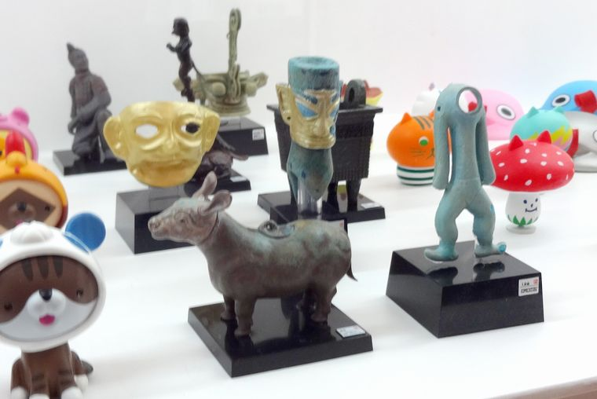

### 概要

販売時期：2012年10月～　販売元：キタンクラブ　価格：400円 
監修：東京国立博物館　企画総指揮：佐藤純也 
公式サイト：<a href="https://ameblo.jp/kitanclub/entry-11370203747.html" target="_blank">コチラ</a> 
2012年にトーハクで開催された特別展、「中国 王朝の至宝」にて限定販売されたカプセルフィギュア。制作はもちろんNTCでおなじみの方々。 
特別展限定ということもあり、NTC台座シリーズよりも入手困難・・・でしたが、2021年の終わりごろ、どこからか在庫が発掘されたのか、一部を除いてネットでお求めやすくなりました。 

### 仕様

素材はPVC。この手のフィギュアはポリストーン製なイメージが強いため、そんな先入観を持って手に取ると感触は軽め。破損しづらいので良いんですけどね。 
台座には超極小文字で展示物に関するデータが書かれていますが、肉眼で読むのは中々難しい・・・。 
付属の個別解説書を読みましょう。 

### 全8種

キタンクラブ10周年展で撮影したもの。
